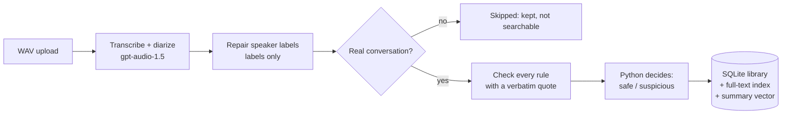
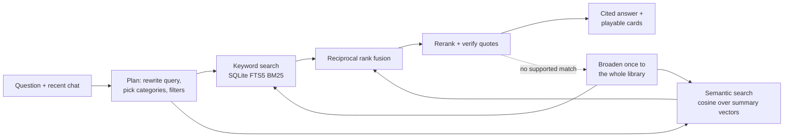

# Call Intelligence

**AI that listens to recorded phone calls, flags dangerous situations with quoted evidence, and lets you search the whole call library in plain language.**

Upload a call and the system transcribes it, separates the two speakers, and checks it against
four clearly defined threat categories. Every flag comes with the exact words that triggered it.
Every analyzed call is saved to a searchable library, so you can ask questions like
*"a husband threatens his wife"* and get cited answers with playable recordings.

| | |
|---|---|
| **Analyze** | Drop in WAV files. Each call is marked **safe** or **suspicious**, with flags, a factual summary, the transcript and the audio. |
| **Library** | Browse every call by category or status, read the evidence, play or download the recording. |
| **Ask** | Search by meaning or exact words, get an answer that cites the matching calls, and ask follow-up questions. |

---

## Contents

- [How it works](#how-it-works)
- [Detection categories](#detection-categories)
- [Why the output can be trusted](#why-the-output-can-be-trusted)
- [Quick start](#quick-start)
- [Usage](#usage)
- [Testing and evaluation](#testing-and-evaluation)
- [Project structure](#project-structure)
- [Configuration](#configuration)
- [Limitations](#limitations)
- [Privacy and security](#privacy-and-security)
- [Credits](#credits)

---

## How it works

### Analysis pipeline



1. **Transcribe.** The audio model writes a verbatim transcript in the spoken language, labels the
   speakers `Person 1` (who speaks first) and `Person 2`, and can mark audible distress.
2. **Repair speaker labels.** A text model fixes turns attributed to the wrong person. Only labels
   may move: if a single word changes, that turn keeps its original wording.
3. **Relevance gate.** Robocalls, voicemail greetings and dropped lines are **skipped**, not analyzed.
   The gate fails open: anything concerning, or any error, goes on to full analysis.
4. **Analyze.** For each rule the model returns a reason, an exact quote and a yes/no answer.
5. **Classify in Python.** A transcript flag survives only if its quote really appears in the
   transcript. Any surviving flag means **suspicious**, none means **safe**. The model never makes
   this final call.
6. **Persist and index.** The audio, transcript, summary and flags are saved in SQLite, and the
   summary is embedded for semantic search.

### Search pipeline



- **Category first.** The planner picks up to two likely categories and searches inside them
  first. If nothing there is supported by evidence, it searches the whole library once more.
- **Hybrid retrieval.** Keyword and vector results are merged with reciprocal rank fusion,
  `1 / (60 + rank)`, so scores from different methods are never compared directly.
- **Verified answers.** Every cited quote is checked against the stored transcript. An invented
  quote or unknown recording is rejected, never shown as evidence.
- **Follow-ups.** "What did he threaten?" is rewritten into a standalone question using the
  previous results.
- **Transparent.** Each answer has a *How this search worked* panel showing the plan, the stages,
  and the rank each recording had in each search branch.

## Detection categories

| ID | Category | Flags when | Does not flag |
|---|---|---|---|
| 1 | Threat of violence | A stated intention to physically harm someone or damage their property | Vague anger, jokes both people laugh off, film plots |
| 2 | Extortion / blackmail | A demand backed by a threat of harm or of exposing private material | Ordinary invoices, legal remedies |
| 3 | Planning a crime | Concrete coordination of a harmful or illegal act | A mysterious package alone |
| 4 | Person in danger | Current injury, confinement, immediate danger or self-harm intent | Abuse that ended long ago |
| 5 | Sounds of distress or violence | Audible screaming or a struggle, judged from the sound (experimental) | Words that only describe violence |
| 6 | Other | Explicit harmful conduct outside 1 to 5, such as sustained harassment | Anything already covered by 1 to 5 |

A call can carry several flags. **Other** is used only when no other category fires, and
Python enforces that. All definitions live in [`rules/threat_detection.json`](rules/threat_detection.json),
so they can be changed without touching code.

**Languages.** Calls can be in many languages: the transcript stays in the spoken language and the
explanations are written in English (`REPORT_LANGUAGE`). The demo set is English.

## Why the output can be trusted

- **Evidence or no flag.** A transcript flag needs a verbatim quote that is found in the
  transcript; otherwise it is dropped. The user sees exactly which words caused it. The text model
  cannot raise the audio flag; only the transcriber, which hears the sound, can.
- **Deterministic final decision.** Models report findings; plain Python turns them into
  safe / suspicious / skipped, so the decision rule is auditable and testable.
- **Narrow, explainable categories.** Fuzzy concepts such as "manipulation" or "fraud" were left
  out on purpose. Every rule lists what does *not* count.
- **Untrusted input.** Transcripts and search questions are treated as data, never as instructions
  to the model (prompt injection is covered by a test case).
- **No silent failures.** Analysis errors are recorded and shown, never classified as safe. If
  embeddings fail, keyword search still works and indexing is retried later.
- **Reproducible.** Models are pinned in code, and each analysis stores a fingerprint of the code,
  rules and settings that produced it. Identical audio is stored once (SHA-256 of the bytes).

## Quick start

**Requirements:** Python 3.12+ and an OpenAI API key.

```bash
git clone https://github.com/PavleBliadze/call-intelligence.git
cd call-intelligence
python -m venv .venv
.venv\Scripts\activate            # Windows   (macOS/Linux: source .venv/bin/activate)
pip install -r requirements.txt
```

Create a `.env` file in the project root:

```env
OPENAI_API_KEY=your_key_here
```

Check the key with `python test.py`.

### Demo recordings

Recordings are not stored in git. Generate the nine scripted calls with OpenAI text-to-speech and
download the one real call (a public-domain robocall):

```bash
python demo/make_calls.py
curl -L -o calls/call_08.wav https://raw.githubusercontent.com/wspr-ncsu/robocall-audio-dataset/main/audio-wav-16khz/807777_normalized.wav
```

Generating and analyzing the whole demo set costs well under US$1 in API usage.

### Run

```bash
python main.py        # analyze everything in calls/ and fill the library
python web/app.py     # open http://127.0.0.1:5050
```

| File | Scenario | Expected result |
|---|---|---|
| `call_01.wav` | Dinner plans | Safe |
| `call_02.wav` | Angry customer, no threats | Safe |
| `call_03.wav` | Violent movie plot and a joke | Safe |
| `call_04.wav` | Neighbor dispute | Threat of violence |
| `call_05.wav` | Private-photo blackmail | Extortion / blackmail |
| `call_06.wav` | Robbery planning with a van | Planning a crime |
| `call_07.wav` | Locked in, asking for help | Person in danger |
| `call_08.wav` | Real automated robocall | Skipped |
| `call_09.wav` | Husband threatens wife after an assault | Threat of violence + Person in danger |
| `call_10.wav` | Repeated unwanted calls and insults | Other |

The three safe calls are deliberate traps: anger, a film plot and a joke all sound alarming but
contain no real threat.

## Usage

### Web console

`python web/app.py` serves the Analyze, Library and Ask views on port 5050. Uploads must be PCM
WAV files up to 100 MB. A web upload always runs a fresh analysis; uploading the same file again
updates its library entry instead of creating a duplicate.

Suggested demo flow:

1. **Library:** pick a category; note that `call_09` belongs to two categories.
2. **Ask:** *"Someone threatens to share private photos unless paid"*, read the quote, play the call.
3. **Ask:** *"A husband threatens his wife"*, then the follow-up *"What did he threaten?"*
4. Open **How this search worked** to show category routing, both search branches and fusion.
5. **Ask:** *"Find a call arranging a scuba-diving holiday"* to show that unrelated questions get
   *No matching recordings found* instead of a forced answer.

### Batch command line

```bash
python main.py              # analyze new or changed recordings, reuse the rest
python main.py --reprocess  # force a fresh analysis of every recording
python main.py --reindex    # rebuild embeddings from saved summaries only
```

Each run also copies results into `safe/` and `suspicious/` with a `.summary.txt` per call, and
writes transcripts to `debug/` and a log to `run.log`. The library in `data/` is never cleared.

### HTTP API

| Endpoint | Purpose |
|---|---|
| `POST /api/analyze` | Multipart `file`: analyze, save and return the result |
| `GET /api/recordings` | Paged list; optional `status` and repeated `category` filters |
| `GET /api/recordings/<id>` | One saved result with its transcript |
| `GET /api/recordings/<id>/audio` | The WAV (supports seeking; `?download=1` downloads it) |
| `GET /api/categories` | Category definitions and counts |
| `POST /api/search` | JSON `query`, optional `history`, `reference_ids`, `categories`, `status`, `rerank` |

## Testing and evaluation

```bash
python -m unittest discover -s demo -p "test_*.py"   # 28 offline tests, no API calls
python demo/evaluate.py --audio                      # all 10 WAVs through the full pipeline
python demo/evaluate.py --repeat 3                   # 9 scripts + 18 boundary cases, text only
python demo/evaluate_search.py --repeat 3            # 9 labeled search questions, 4 modes
ruff check . && ruff format --check .                # lint and formatting (pip install ruff)
```

The offline tests use a temporary database and mocked model calls. They cover evidence
validation, category precedence, deduplication, versioned re-analysis, embedding failure and
recovery, quote verification in search, category fallback, follow-up references and the API.

**Classification (live, 2026-10-21):** 10 of 10 audio recordings and 27 of 27 text cases matched
their expected status and flags. The text cases include traps such as jokes, film plots,
lawful payment reminders, a spoken prompt injection and an unclear threat.

**Search (live, category-first strategy, 9 questions including two follow-ups and one
unrelated question):**

| Mode | Recall@3 | MRR | Mean latency | Rejects unrelated question |
|---|---:|---:|---:|---:|
| Keyword only | 0.875 | 0.813 | 1.67 s | no |
| Vector only | 1.000 | 1.000 | 2.17 s | no |
| Hybrid | 1.000 | 0.938 | 2.13 s | no |
| **Hybrid + reranking (default)** | **1.000** | **1.000** | 4.05 s | **yes** |

Raw retrieval always returns its nearest candidates; only the reranking step can say "no match".
Full per-query reports are written to `debug/`; summaries are kept in
[`demo/evaluation_results_category_first.json`](demo/evaluation_results_category_first.json)
(current strategy), with earlier strategies in `demo/evaluation_results*.json`.

These numbers come from a small, mostly synthetic development set and show that the design
works end to end. They are not an independent accuracy benchmark.

## Project structure

| Path | Responsibility |
|---|---|
| `main.py` | Batch command line over `calls/` |
| `web/app.py` | Flask + waitress web server and JSON API |
| `web/static/console.jsx` | React interface (compiled in the browser, no build step) |
| `ingestion.py` | One shared pipeline for uploads and batch runs: validate, deduplicate, analyze, save |
| `transcriber.py` | Audio to diarized transcript, with chunking for long calls |
| `speaker_repair.py` | Corrects speaker labels without changing any words |
| `relevance_guard.py` | Skips calls with no real conversation (fails open) |
| `analyzer.py` | Rule checks, evidence validation and the final verdict |
| `classifier.py` | Verdict to safe / suspicious / skipped |
| `library.py` | SQLite catalog, full-text index and stored vectors |
| `embeddings.py` | Summary and query embeddings |
| `search.py` | Query planning, hybrid retrieval, fusion, reranking and fallback |
| `openai_json.py` | One robust model call: structured output, retries, timeouts |
| `rules_loader.py`, `rules/` | Loads and validates the category definitions |
| `config.py` | All settings and paths in one place |
| `summary_writer.py`, `file_organizer.py`, `debug_dump.py`, `logger_setup.py` | Batch outputs and logging |
| `demo/` | Call scripts and generator, test cases, evaluations, unit tests |

### Models

| Task | Model |
|---|---|
| Transcription and audible distress | `gpt-audio-1.5` |
| Speaker repair, relevance gate, query planning | `gpt-5.4-mini` (low reasoning) |
| Classification and summary, search reranking | `gpt-5.4-mini` (medium reasoning) |
| Embeddings | `text-embedding-3-small`, 1,536 dimensions |
| Demo speech generation | `gpt-4o-mini-tts` |

## Configuration

All settings are optional except the API key and go in `.env`:

| Variable | Default | Meaning |
|---|---|---|
| `OPENAI_API_KEY` | none | Required |
| `REPORT_LANGUAGE` | `English` | Language of explanations and summaries |
| `RULESET` | `threat_detection` | Which `rules/<name>.json` to use |
| `SPEAKER_REPAIR_ENABLED` | `true` | Turn the speaker-label repair on or off |
| `RELEVANCE_GATE_ENABLED` | `true` | Turn the relevance gate on or off |
| `TRANSCRIBE_CHUNK_SECONDS` | `300` | Chunk length for very long recordings |
| `WEB_HOST` / `WEB_PORT` / `WEB_THREADS` | `127.0.0.1` / `5050` / `6` | Web server |

Models are pinned in `config.py`. Restart the server after changing code or rules; recordings
analyzed by an older version are re-analyzed on the next batch run.

## Limitations

- The demo set is small and mostly synthetic, so it shows the method rather than real-world accuracy.
- Audio distress detection is experimental: synthetic "screaming" is heard as shouting.
- Speaker numbers follow speaking order and can swap if a short opening "Hello?" is missed.
- Search compares vectors exactly in memory, which suits thousands of calls, not millions.
- Only PCM WAV is accepted, and there are no word-level timestamps for jumping to a quote.

## Privacy and security

- Audio, transcripts and search questions are sent to OpenAI for processing. Only use recordings
  you are allowed to process.
- The web console has no login. It listens on localhost by default; share it only on a trusted network.
- Recordings, the database, reports and `.env` are git-ignored and never committed.

## Credits

- `call_08.wav` comes from the [NCSU robocall audio dataset](https://github.com/wspr-ncsu/robocall-audio-dataset)
  (public domain), original file `807777_normalized.wav`.
- React, ReactDOM and Babel are bundled locally under the MIT license; see
  [`web/static/vendor/README.txt`](web/static/vendor/README.txt).
- All other demo voices are AI-generated with OpenAI text-to-speech.
